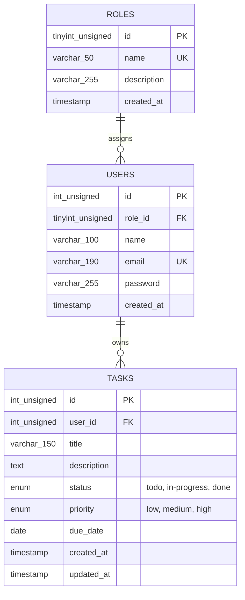

# Task Manager --- Full-Stack CRUD & Authentication

A full-stack Task Manager built with **React + Vite**, **Core PHP
(MySQLi)**, and **MySQL**.

## Test Accounts & Credentials

For testing and evaluating the application, the following default/seed credentials can be used:

### Regular User

- **Name:** `workomkar`
- **Email:** `workomkar@gmail.com`
- **Password:** `omkaradsdmin123`
- **Role:** `user`

```json
{
  "name": "workomkar",
  "email": "workomkar@gmail.com",
  "password": "omkaradsdmin123",
  "role": "user"
}
```

### Administrator

- **Name:** `Administrator`
- **Email:** `admin@example.com`
- **Password:** `Admin@12345`
- **Role:** `admin`

```json
{
  "name": "Administrator",
  "email": "admin@example.com",
  "password": "Admin@12345"
}
```
> **Note:** For security in production, always change default passwords and configure appropriate credential management.

## Features

### Task CRUD

- Create, list, update, and delete tasks.
- Task fields: title, description, status, priority, due date, and
  owner (`user_id`).
- Status values: `todo`, `in-progress`, `done`.
- Priority values: `low`, `medium`, `high`.
- Search by title, filter by status, and paginate task results.
- Client-side and server-side validation.
- Loading, success, and error states.

### Authentication and Authorization

- Registration and login using `password_hash()` and
  `password_verify()`.
- Session-based authentication for protected API endpoints.
- `admin` and `user` roles.
- Users can manage only their own tasks; admins can manage tasks
  across users.
- React checks the current session and hides admin-only UI from
  regular users.
- Logout and inactivity-based session expiry.
- Prepared statements for user-supplied SQL values.

## Technology

- Frontend: React, Vite, Axios
- Backend: Core PHP, MySQLi
- Database: MySQL
- Local environment: WAMP on Windows

## Project Structure

```text
Comp/
├── backend/
│   ├── api/
│   │   ├── auth.php
│   │   ├── authMiddleware.php
│   │   └── tasks.php
│   └── config/
│       ├── cors.php
│       ├── db.php
│       └── session.php
└── frontend/
    ├── src/
    │   ├── api/authApi.js
    │   ├── api/tasksApi.js
    │   ├── components/Dashboard.jsx
    │   ├── pages/Login.jsx
    │   └── App.jsx
    └── package.json
```

## Local Setup

### Backend

1.  Place the project in `C:\wamp64\www\Comp\`.
2.  Start Apache and MySQL in WAMP.
3.  In phpMyAdmin, select or create the `task-manager-backend` database.
4.  Check `backend/config/db.php` and set the correct database host,
    username, password, and database name.
5.  Ensure your tables match the schema and column names expected by the
    PHP code.

### Frontend

> **Note:** The `node_modules/` folder is intentionally ignored and not uploaded to GitHub. After cloning the repository, you must install the dependencies manually.

1. Open a terminal in the frontend directory:
   ```bash
   cd frontend
   ```
2. Install dependencies:
   ```bash
   npm install
   ```
3. Start the Vite development server:
   ```bash
   npm run dev
   ```

Open `http://localhost:5173/`.

The Axios clients should use: -
`http://localhost/Comp/backend/api/auth.php` -
`http://localhost/Comp/backend/api/tasks.php`

Both clients need `withCredentials: true` for PHP session cookies.

## Database Overview

The current application design uses a `users` table with a `role`
column. It does not require a separate `roles` table unless you
intentionally migrate the app to a normalized role schema.

### `users`

Column Purpose

---

`id` Primary key
`name` User's display name
`email` Unique login email
`password` Password hash; never store plain-text passwords
`role` `admin` or `user`
`created_at` Account creation time

### `tasks`

Column Purpose

---

`id` Primary key
`title` Required task title
`description` Optional task details
`status` `todo`, `in-progress`, or `done`
`priority` `low`, `medium`, or `high`
`due_date` Optional due date
`user_id` Task owner; should reference `users.id`
`created_at` Creation timestamp
`updated_at` Last update timestamp

### Example schema for a new database

**Do not run this over your existing database unchanged.** Back up and
reconcile existing data first, especially task owners.

```sql
CREATE TABLE users (
    id INT UNSIGNED AUTO_INCREMENT PRIMARY KEY,
    name VARCHAR(100) NOT NULL,
    email VARCHAR(190) NOT NULL UNIQUE,
    password VARCHAR(255) NOT NULL,
    role ENUM('admin', 'user') NOT NULL DEFAULT 'user',
    created_at TIMESTAMP DEFAULT CURRENT_TIMESTAMP
) ENGINE=InnoDB;

CREATE TABLE tasks (
    id INT UNSIGNED AUTO_INCREMENT PRIMARY KEY,
    title VARCHAR(150) NOT NULL,
    description TEXT NULL,
    status ENUM('todo', 'in-progress', 'done') NOT NULL DEFAULT 'todo',
    priority ENUM('low', 'medium', 'high') NOT NULL DEFAULT 'medium',
    due_date DATE NULL,
    user_id INT UNSIGNED NOT NULL,
    created_at TIMESTAMP DEFAULT CURRENT_TIMESTAMP,
    updated_at TIMESTAMP DEFAULT CURRENT_TIMESTAMP ON UPDATE CURRENT_TIMESTAMP,
    CONSTRAINT fk_tasks_user
        FOREIGN KEY (user_id) REFERENCES users(id)
        ON UPDATE RESTRICT ON DELETE CASCADE,
    INDEX idx_tasks_user_status_id (user_id, status, id),
    INDEX idx_tasks_user_id (user_id, id)
) ENGINE=InnoDB;
```

## API Reference

### Authentication API

Base URL: `http://localhost/Comp/backend/api/auth.php`

Method Endpoint Purpose

---

POST `auth.php?action=register` Register a regular user
POST `auth.php?action=login` Log in
GET `auth.php?action=me` Check current session
POST `auth.php?action=logout` Log out

Example registration body:

```json
{
  "name": "Example User",
  "email": "user@example.com",
  "password": "Choose-a-strong-password"
}
```

Example login body:

```json
{
  "email": "user@example.com",
  "password": "Choose-a-strong-password"
}
```

Public registration should assign the `user` role by default. Grant
admin access only through a controlled administrative process.

### Tasks API

Base URL: `http://localhost/Comp/backend/api/tasks.php`

---

Method Endpoint Purpose

---

GET `tasks.php` List accessible tasks

GET `tasks.php?page=1&per_page=5` Paginated list

GET `tasks.php?status=todo` Filter by status

GET `tasks.php?search=report` Search task titles

POST `tasks.php` Create a task

PUT `tasks.php?id=TASK_ID` Update a task

PATCH `tasks.php?id=TASK_ID` Partially update a
task, if supported

DELETE `tasks.php?id=TASK_ID` Delete a task

---

Example task body:

```json
{
  "title": "Prepare project README",
  "description": "Document setup and endpoints",
  "status": "todo",
  "priority": "medium",
  "due_date": "2026-12-31"
}
```

The backend should derive a regular user's `user_id` from the
authenticated session rather than trusting an owner ID supplied by the
client.

A typical paginated response can include `data` and `pagination` fields.
The exact response shape should match the current implementation of
`tasks.php`.

## Authorization and HTTP Status Codes

- `401 Unauthorized`: no valid authenticated session.
- `403 Forbidden`: authenticated user lacks permission.
- `404 Not Found`: may be used for another user's task to avoid
  revealing its existence.
- `400 Bad Request` or `422 Unprocessable Entity`: invalid request
  data, depending on the API's conventions.
- `201 Created`: successful creation.
- `200 OK`: successful reads or updates.
- `204 No Content` or `200 OK`: successful deletion, depending on
  implementation.

Every protected action must be authorized in PHP. Hiding a button in
React is not a security boundary. Password hashes must never be returned
in API responses.

## CORS and Session Notes

- Allow the exact frontend origin `http://localhost:5173`.
- Send `Access-Control-Allow-Credentials: true` and use
  `withCredentials: true` in Axios.
- Handle `OPTIONS` preflight requests before running normal API
  actions.
- The session configuration is intended to expire inactive sessions
  after 30 minutes.
- Use the same hostname consistently; avoid mixing `localhost` and
  `127.0.0.1`.

For production, use HTTPS and secure cookies, restrict CORS, disable PHP
error display, log errors server-side, implement CSRF protection for
cookie-authenticated write requests, and remove temporary setup scripts.

## Validation and SQL Safety

- Validate title, status, priority, and due-date values on both
  frontend and backend.
- Use MySQLi prepared statements for user-controlled SQL values.
- Do not concatenate untrusted values into SQL statements.
- Store passwords with `password_hash()` and verify with
  `password_verify()`.
- Do not expose SQL errors or stack traces to clients.

## Database Design & Query Optimization (Core)

### 1. Schema Design (DDL & Entity Relationships)

The database schema supports both the current lightweight role model (`ENUM('admin', 'user')` on `users`) and a normalized enterprise role model (`roles` + `users` + `tasks`).

#### Normalized Schema (DDL)

```sql
-- 1. Roles table
CREATE TABLE roles (
    id TINYINT UNSIGNED AUTO_INCREMENT PRIMARY KEY,
    name VARCHAR(50) NOT NULL UNIQUE,
    description VARCHAR(255) NULL,
    created_at TIMESTAMP DEFAULT CURRENT_TIMESTAMP
) ENGINE=InnoDB DEFAULT CHARSET=utf8mb4 COLLATE=utf8mb4_unicode_ci;

-- Seed default roles
INSERT INTO roles (id, name, description) VALUES
(1, 'admin', 'System administrator with cross-user privileges'),
(2, 'user', 'Regular user with ownership-restricted privileges');

-- 2. Users table
CREATE TABLE users (
    id INT UNSIGNED AUTO_INCREMENT PRIMARY KEY,
    role_id TINYINT UNSIGNED NOT NULL DEFAULT 2,
    name VARCHAR(100) NOT NULL,
    email VARCHAR(190) NOT NULL UNIQUE,
    password VARCHAR(255) NOT NULL,
    created_at TIMESTAMP DEFAULT CURRENT_TIMESTAMP,
    CONSTRAINT fk_users_role
        FOREIGN KEY (role_id) REFERENCES roles(id)
        ON UPDATE CASCADE ON DELETE RESTRICT
) ENGINE=InnoDB DEFAULT CHARSET=utf8mb4 COLLATE=utf8mb4_unicode_ci;

-- 3. Tasks table
CREATE TABLE tasks (
    id INT UNSIGNED AUTO_INCREMENT PRIMARY KEY,
    user_id INT UNSIGNED NOT NULL,
    title VARCHAR(150) NOT NULL,
    description TEXT NULL,
    status ENUM('todo', 'in-progress', 'done') NOT NULL DEFAULT 'todo',
    priority ENUM('low', 'medium', 'high') NOT NULL DEFAULT 'medium',
    due_date DATE NULL,
    created_at TIMESTAMP DEFAULT CURRENT_TIMESTAMP,
    updated_at TIMESTAMP DEFAULT CURRENT_TIMESTAMP ON UPDATE CURRENT_TIMESTAMP,
    CONSTRAINT fk_tasks_user
        FOREIGN KEY (user_id) REFERENCES users(id)
        ON UPDATE RESTRICT ON DELETE CASCADE,
    -- Composite index for user task listing, status filter, and pagination
    INDEX idx_tasks_user_status_id (user_id, status, id),
    -- Index for ownership queries and user-level task counts/ordering
    INDEX idx_tasks_user_id (user_id, id),
    -- Index for admin cross-user listing by status and ordering
    INDEX idx_tasks_status_id (status, id)
) ENGINE=InnoDB DEFAULT CHARSET=utf8mb4 COLLATE=utf8mb4_unicode_ci;
```

#### Entity-Relationship Diagram (ERD)



---

### 2. Core Optimized Application Queries

#### Query 1: Regular User's Tasks Filtered by Status (with Pagination)
Used in user dashboard task view:
```sql
SELECT id, title, description, status, priority, due_date, created_at, updated_at
FROM tasks
WHERE user_id = 1 AND status = 'todo'
ORDER BY id DESC
LIMIT 10 OFFSET 0;
```

#### Query 2: Admin View of All Tasks with Owner Information
Used in administrative oversight dashboards:
```sql
SELECT 
    t.id AS task_id,
    t.title,
    t.status,
    t.priority,
    t.due_date,
    t.created_at,
    u.id AS owner_id,
    u.name AS owner_name,
    u.email AS owner_email,
    r.name AS owner_role
FROM tasks t
INNER JOIN users u ON t.user_id = u.id
INNER JOIN roles r ON u.role_id = r.id
ORDER BY t.id DESC
LIMIT 20 OFFSET 0;
```

#### Query 3: Task Counts per User by Status (Aggregated Analytics)
Used in team reporting / task breakdown metrics:
```sql
SELECT 
    u.id AS user_id,
    u.name,
    u.email,
    COUNT(t.id) AS total_tasks,
    COUNT(CASE WHEN t.status = 'todo' THEN 1 END) AS todo_count,
    COUNT(CASE WHEN t.status = 'in-progress' THEN 1 END) AS in_progress_count,
    COUNT(CASE WHEN t.status = 'done' THEN 1 END) AS done_count
FROM users u
LEFT JOIN tasks t ON u.id = t.user_id
GROUP BY u.id, u.name, u.email;
```

---

### 3. EXPLAIN Analysis & Index Justifications

#### A. Query 1 Tuning & Justification
- **Index Applied:** `idx_tasks_user_status_id (user_id, status, id)`
- **EXPLAIN Output:**
  ```text
  id: 1
  select_type: SIMPLE
  table: tasks
  type: ref
  possible_keys: fk_tasks_user, idx_tasks_user_status_id, idx_tasks_user_id
  key: idx_tasks_user_status_id
  key_len: 6 (4 bytes user_id INT + 2 bytes status ENUM nullable/length)
  ref: const, const
  rows: 10
  filtered: 100.00
  Extra: Using where; Backward index scan
  ```
- **Why it is optimized:**
  - Satisfies equality checks on both `user_id` and `status` via `ref` access.
  - The third column in the index (`id`) allows MySQL to read keys in reverse order without performing an expensive `Using filesort`.

#### B. Query 2 Tuning & Justification
- **Index Applied:** `PRIMARY` on `tasks.id`, `PRIMARY` on `users.id`, and `PRIMARY` on `roles.id`
- **EXPLAIN Output:**
  ```text
  id: 1 | select_type: SIMPLE | table: t | type: index | key: PRIMARY | rows: 20 | Extra: Backward index scan
  id: 1 | select_type: SIMPLE | table: u | type: eq_ref | key: PRIMARY | ref: t.user_id | rows: 1 | Extra: NULL
  id: 1 | select_type: SIMPLE | table: r | type: eq_ref | key: PRIMARY | ref: u.role_id | rows: 1 | Extra: NULL
  ```
- **Why it is optimized:**
  - Driving table `tasks` traverses its clustered index (`PRIMARY`) descending to satisfy `ORDER BY t.id DESC LIMIT 20` directly with no temporary table or filesort.
  - Lookups into `users` and `roles` execute via `eq_ref` on their respective primary keys, guaranteeing exactly 1 row lookup per task row.

#### C. Query 3 Tuning & Justification
- **Index Applied:** `idx_tasks_user_id (user_id, id)`
- **EXPLAIN Output:**
  ```text
  id: 1 | select_type: SIMPLE | table: u | type: ALL | possible_keys: PRIMARY | rows: N | Extra: NULL
  id: 1 | select_type: SIMPLE | table: t | type: ref | key: idx_tasks_user_id | key_len: 4 | ref: u.id | Extra: NULL
  ```
- **Why it is optimized:**
  - Employs conditional aggregation (`COUNT(CASE WHEN ... END)`) over a single scan per user rather than running 4 separate subqueries.
  - `idx_tasks_user_id` provides direct `ref` join access on `user_id` so the database does not perform full table scans on tasks.

---

## Indexing and Query Optimization

Indexes for common task queries may include: - `(user_id, status, id)`
for a user's tasks filtered by status and ordered by ID. -
`(user_id, id)` for a user's tasks ordered by ID without a status
filter. - The primary key on `users.id` for joining task owners. - The
unique index on `users.email` for login lookup.

Run `EXPLAIN` on the actual queries and inspect the selected `key`,
estimated `rows`, access `type`, and `Extra` fields. Confirm the real
query plan before claiming a specific index is used.

## Testing Checklist

### CRUD

- [ ] Create a valid task.
- [ ] Reject an empty title or invalid status/priority.
- [ ] List tasks and verify pagination.
- [ ] Filter by status and search by title.
- [ ] Edit a task and verify the change.
- [ ] Change status and delete a task.

### Authentication and Authorization

- [ ] Register a regular user.
- [ ] Verify the password is stored as a hash.
- [ ] Log in and check `auth.php?action=me`.
- [ ] Request tasks without a session and expect `401`.
- [ ] Verify User A cannot view, update, or delete User B's tasks.
- [ ] Verify admin access to tasks across users.
- [ ] Log out and confirm protected requests reject the old session.
- [ ] Verify session expiry.
- [ ] Confirm regular users do not see admin-only controls.

For Postman, log in first and retain the PHP session cookie for
subsequent requests.

## Troubleshooting

### CORS errors

- Check `backend/config/cors.php`.
- Include CORS configuration before output in each API endpoint.
- Confirm the allowed origin exactly matches `http://localhost:5173`.
- Check the Network tab for the `OPTIONS` response and headers.

### Invalid email or password

- Confirm the email exists in the database configured in `db.php`.
- Confirm the password column contains a password hash.
- Confirm login uses `password_verify()` and selects the `password`
  and `role` columns.

### Session is lost after login

- Check `withCredentials: true` in both Axios clients.
- Check CORS credential headers and session cookie path.
- Use the same hostname for frontend API calls and browser testing.
